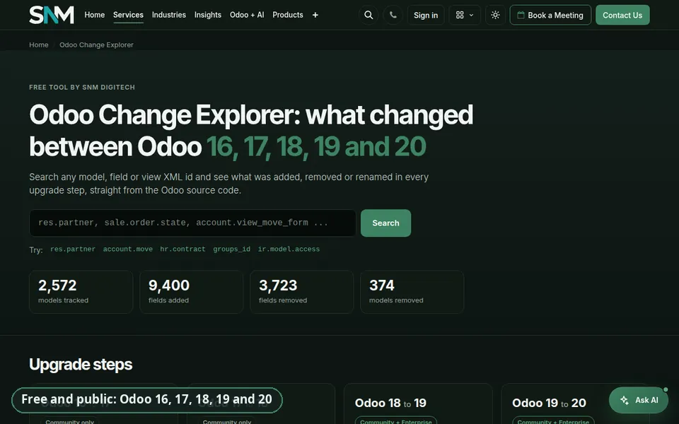
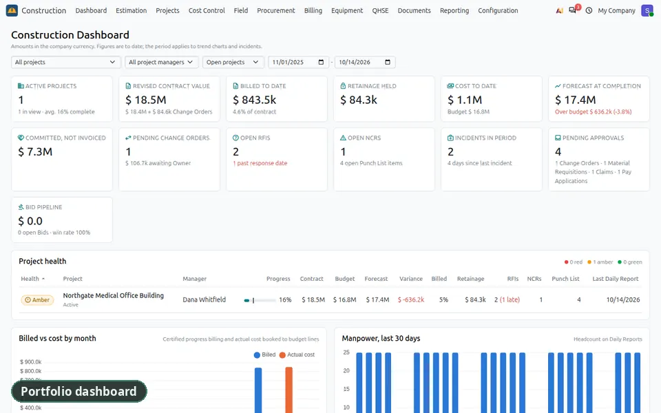
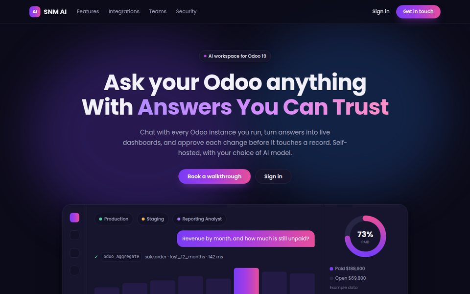
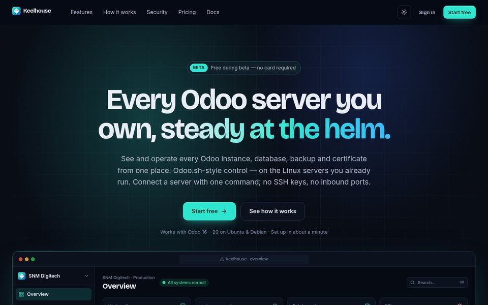
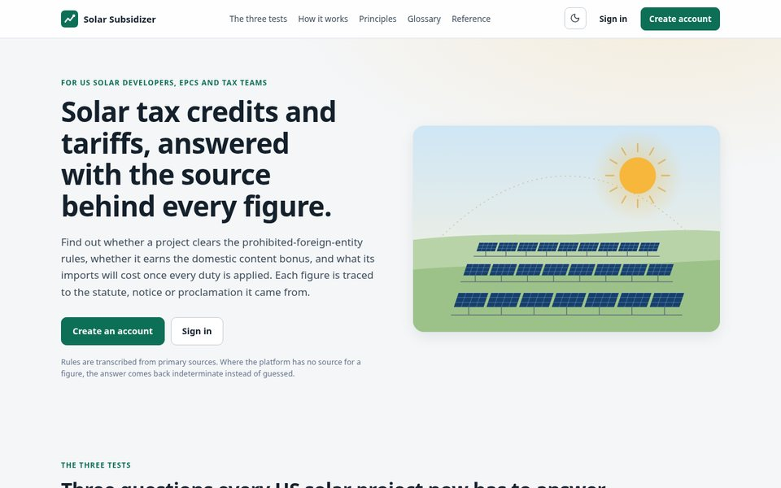
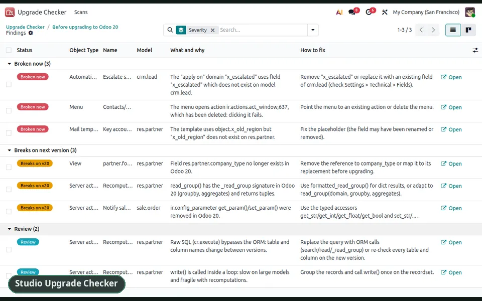
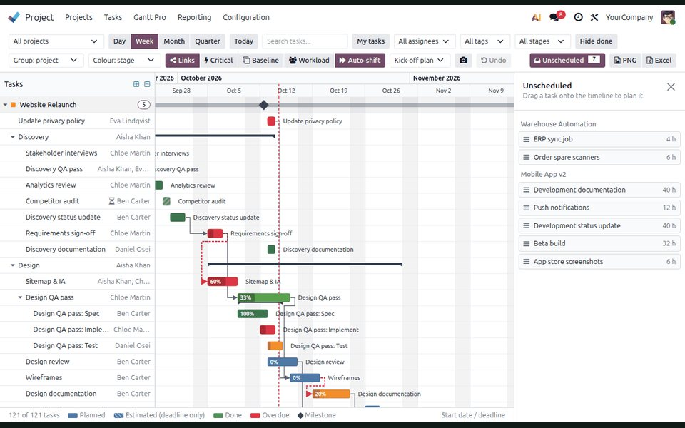

<!-- Profile README for Subash Magar · https://subashmagar.com -->

  
  
  
  
  
  

 

<picture>
  <source media="(prefers-color-scheme: dark)" srcset="assets/proof-strip-dark.svg">
  
</picture>

# Subash Magar

**Odoo consultant and developer** at [SNM Digitech and Consulting](https://snmdigitechconsulting.com) · Lalitpur, Nepal · working with clients in the US, Australia and Nepal

I implement, customise and upgrade Odoo, and I build the apps and platforms around it. Most of my work runs on every supported release, **Odoo 16 to Odoo 20**, Community and Enterprise, and ships with its own automated tests.

---

## What I build

- **Odoo implementation and customisation**: Sales, CRM, Inventory, Purchase, Accounting, Manufacturing, Project, HR, Payroll, Website and eCommerce, with custom modules where the standard falls short.
- **Version upgrades**: custom modules ported across major releases (16 → 20), Studio customisations audited and repaired, data migrated and reconciled.
- **Vertical ERPs on Odoo**: a full construction ERP and a solar EPC package, built as Odoo modules.
- **AI for Odoo**: an assistant that answers from live Odoo data under the user's own access rights, and a self-hosted AI workspace with dashboards and approvals.
- **Tools around Odoo**: control for many Odoo servers, analytics with Metabase, compliance engines, and free data products for the Odoo community.

---

## Products and platforms

#### [Odoo Change Explorer](https://snmdigitechconsulting.com/odoo-changes) · free, public
What changed between Odoo 16, 17, 18, 19 and 20, model by model and field by field: fields and models added, removed or renamed, and the breaking changes behind each upgrade. Generated by comparing the real Odoo source of each release (2,572 models; Enterprise covered for 18 → 19 and 19 → 20).

#### SNM Construction ERP · 13 Odoo modules
Bids and bills of quantities, contracts with retainage and change orders, budget and cost control by cost code, procurement with multi-level approvals, daily field reports, progress billing (pay applications), QHSE, drawings and RFIs, equipment, a client and subcontractor portal, and executive dashboards. Runs on Odoo 19 and Odoo 20 with 221 automated tests, project-level data isolation, and cost figures hidden from field and portal users.

#### Solar EPC package · Odoo modules
Built on the construction platform: site survey and system design, proposals and financing, permitting and interconnection clocks, serial-number traceability, installation, incentives, commissioning, O&M and a customer portal.

#### [Solar Subsidizer](https://solar.snmdigitechconsulting.com)
Deterministic FEOC, domestic-content and tariff determinations for US solar projects, every result traced to versioned primary sources.

#### [SNM AI Workspace](https://aiconnect.snmdigitechconsulting.com)
A self-hosted AI workspace for Odoo: chat across several Odoo instances, live dashboards, MCP tools, and human approval for every write.

#### [Keelhouse](https://keelhouse.snmdigitechconsulting.com)
Control for every Odoo server: lightweight agents on each host, with all instances and databases managed from one place.

<table>
  <tr>
    <td width="33%"></td>
    <td width="33%"></td>
    <td width="33%"></td>
  </tr>
  <tr>
    <td align="center">SNM AI Workspace</td>
    <td align="center">Keelhouse</td>
    <td align="center">Solar Subsidizer</td>
  </tr>
</table>

#### Swift ERP
SNM's own build of Odoo, including a construction edition. Screens on [snmdigitechconsulting.com](https://snmdigitechconsulting.com).

---

## Odoo Apps Store

Published by SNM Digitech and Consulting; each one runs on Odoo 16 to 20 unless noted.

| App | Price | What it does |
|---|---|---|
| [Studio Upgrade Checker](https://apps.odoo.com/apps/modules/19.0/snm_studio_upgrade_checker/) | $100 | Lists every Studio and custom change, flags what is broken now and what breaks on the next Odoo version |
| [Studio View Repair Assistant](https://apps.odoo.com/apps/modules/19.0/snm_view_repair/) | $50 | Diagnoses broken custom views and fixes them with preview, backup and one-click restore |
| [Automation & Cron Failure Monitor](https://apps.odoo.com/apps/modules/19.0/snm_failure_monitor/) | $50 | Alerts when scheduled actions, automations or server actions fail |
| [Access Manager](https://apps.odoo.com/apps/modules/19.0/snm_access_manager/) | $50 | Roles, an access dashboard and hidden menus without technical setup |
| [AI Assistant](https://apps.odoo.com/apps/modules/19.0/snm_ai_assistant/) | $50 | Answers, charts and dashboards from live Odoo data; writes only with approval |
| [Payroll Excel Report](https://apps.odoo.com/apps/modules/19.0/snm_payroll_excel_report/) | $20 | Payroll register in Excel by employee and salary rule (Enterprise, 18 to 20) |
| [Quotation e-Signature](https://apps.odoo.com/apps/modules/19.0/snm_sale_sign/) | $10 | Sends quotations to Odoo Sign in one click (Enterprise, 18 to 20) |
| [CRM Dashboard](https://apps.odoo.com/apps/modules/19.0/snm_crm_dashboard/) | Free | Pipeline, wins, activities and the sales leaderboard on one screen |
| [Financial Reports](https://apps.odoo.com/apps/modules/19.0/snm_financial_reports/) | Free | Balance Sheet, P&L, Trial Balance, ledgers and aged balances for Odoo Community |
| [Invoice Due Reminder](https://apps.odoo.com/apps/modules/19.0/snm_invoice_due_reminder/) | Free | Automatic reminders before, on or after the due date |
| [Supply vs Demand Report](https://apps.odoo.com/apps/modules/19.0/snm_supply_demand_report/) | Free | Month-wise receipts vs deliveries with an 18-month forecast |
| [Survey Recipient Finder](https://apps.odoo.com/apps/modules/19.0/snm_survey_recipients/) | Free | Invites customers who bought recently from the survey Share window |
| [All Activities Tracker](https://apps.odoo.com/apps/modules/19.0/snm_all_activity/) | Free | Every open activity of a contact, its orders, invoices and leads in one window |
| [Employee Events Reminder](https://apps.odoo.com/apps/modules/19.0/snm_employee_events_reminder/) | Free | Birthdays, work anniversaries and HR announcements in a top-bar bell |

Also built: **Project Gantt Pro** for Odoo 19, with dependencies, the critical path, baselines and team workload.

---

## Selected client work

#### US solar equipment distributor · Odoo 19 Enterprise
Moved onto Odoo 19 and supported since: inventory costing and cost-of-goods corrections with an audit screen, purchasing and sales customisations, US payroll adjustments and payroll reporting, financial and inventory-versus-balance-sheet reports, role-based access management, a B2B customer portal, safeguards for test copies, and an AI assistant inside Odoo.

#### A custom module across four major releases
Migrated a real custom module from Odoo 16 to Odoo 20 and documented every breaking change and its fix: [Upgrading to Odoo 20](https://snmdigitechconsulting.com/blog/snm-insights-1/upgrading-to-odoo-20-what-we-learned-migrating-a-custom-module-from-odoo-16-2).

#### Construction and solar EPC
Designed and built the SNM Construction ERP and the solar EPC package above, from estimation to handover, with client portals and executive dashboards.

---

## Writing

Guides on [SNM Insights](https://snmdigitechconsulting.com/blog): Odoo 20 release notes app by app, upgrading custom modules, Odoo pricing and the new light user, hosting (Odoo Online vs Odoo.sh vs on-premise), Odoo with Metabase, Shopify and WooCommerce integration, Odoo vs other ERPs, and Odoo with AI.

---

## Notes for Odoo developers

- [Odoo 19 → 20 porting cheat sheet](https://gist.github.com/msubash1996/c91cfdaaaa550a1d476cc67b29b48d0c): security (`ir.access`), ORM, QWeb `t-call`, OWL 3, portal
- [Odoo 16 → 20 differences for module authors](https://gist.github.com/msubash1996/8f94c2e1feb8b4c719fe6d8c8d6f704d): views, cron, products, groups, constraints, icons
- [What apps.odoo.com strips from your app page](https://gist.github.com/msubash1996/2e7cca04d9f38e093a886b479a251ca0), with fix and check scripts
- [Custom dashboard won't scroll in Odoo 17-20](https://gist.github.com/msubash1996/42a76af90a96580569829e5167a3bb89): the `.o_action` overflow fix

---

## ERPNext

- [commission_management](https://github.com/msubash1996/commission_management): sales commission plans, accruals, clawbacks and payouts
- [supply_demand](https://github.com/msubash1996/supply_demand): time-phased supply and demand for stock items

---

## GitHub activity

  
  

---

## Technical stack

| Domain | Technologies |
| :--- | :--- |
| **ERP** | Odoo 16 to 20 (ORM, OWL, QWeb, Studio) · ERPNext / Frappe |
| **Backend & data** | Python · PostgreSQL · FastAPI · REST · XML-RPC / JSON-RPC · MCP |
| **Frontend** | JavaScript · OWL · TypeScript · Next.js · SCSS |
| **Analytics & AI** | Metabase · Anthropic Claude · OpenAI · NVIDIA models |
| **DevOps** | Linux · nginx · systemd · Docker · Odoo.sh · DigitalOcean |

---

## Contact

Planning an Odoo rollout, an upgrade, or an app built around your process?

[Portfolio](https://subashmagar.com) · [SNM Digitech](https://snmdigitechconsulting.com) · [Book a call](https://snmdigitechconsulting.com/appointment) · [LinkedIn](https://www.linkedin.com/in/subash-magar-a198b9264/) · [Upwork](https://www.upwork.com/freelancers/subashm5) · hello@snmdigitechconsulting.com
